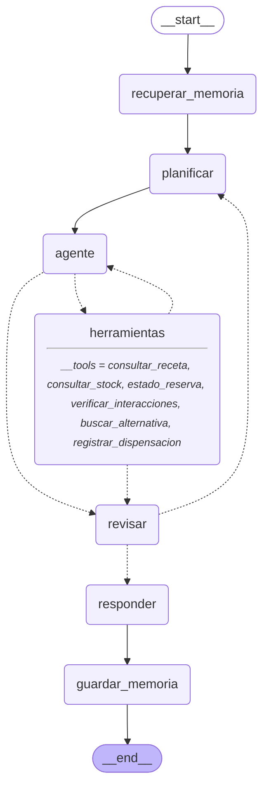

# RecetaYa — Agente de apoyo al farmacéutico

Agente construido con **LangGraph + LangChain + Gemini** para una cadena de
farmacias ficticia. Apoya al farmacéutico a consultar recetas y stock, revisar
interacciones con RAG sobre fichas técnicas, buscar alternativas y registrar
dispensaciones **solo con confirmación humana**.

El agente **nunca prescribe ni cambia dosis**: informa y entrega evidencia
citada; la decisión final es del farmacéutico. Los microservicios (Recetas,
Inventario, Dispensación, Autenticación/Usuarios) se simulan en SQLite y JSON;
el único servicio externo es el LLM.

## Requisitos

- Python 3.11 o superior (probado con 3.13.9).
- Una API key de Google AI Studio para Gemini.
- Opcional (plan B): Ollama local con `langchain-ollama`.

## Instalación

```powershell
python -m venv .venv
.\.venv\Scripts\Activate.ps1
pip install -r requirements.txt
```

En Linux/macOS: `python -m venv .venv && source .venv/bin/activate`.

## Obtener la API key de Gemini

1. Entra a <https://aistudio.google.com/apikey>.
2. Crea o selecciona un proyecto y genera una API key.
3. Copia `.env.example` a `.env` y completa `GOOGLE_API_KEY`.
4. Si el proyecto no tiene disponible el nivel gratuito, habilita facturación
   en <https://aistudio.google.com/billing>.

`.env` está en `.gitignore`: nunca se sube una clave al repositorio.

## Configuración del `.env`

```env
PROVEEDOR=gemini
GOOGLE_API_KEY=tu_api_key
MODELO_LLM=gemini-3.5-flash-lite
MODELO_EMBEDDINGS=gemini-embedding-001
DIM_EMBEDDINGS=768
MAX_ITERACIONES=6
MAX_REPLANIFICACIONES=1
INVENTARIO_CAIDO=0
```

| Variable | Uso |
|---|---|
| `PROVEEDOR` | `gemini` (por defecto) u `ollama` |
| `GOOGLE_API_KEY` | clave de Gemini |
| `MODELO_LLM` | modelo de chat; por defecto `gemini-3.5-flash-lite` |
| `MODELO_EMBEDDINGS` | `gemini-embedding-001` |
| `DIM_EMBEDDINGS` | dimensión de salida de embeddings (768) |
| `MAX_ITERACIONES` | máximo de vueltas agente → herramientas |
| `MAX_REPLANIFICACIONES` | replanificaciones por turno |
| `INVENTARIO_CAIDO` | `1` simula la caída del servicio de Inventario |

En Gemini se configura `temperature=0` y `max_retries=3` en `src/config.py`.
El modelo `gemini-3.5-flash-lite` usa sampling fijo e ignora `temperature`
(aviso esperado); se mantiene por requisito.

### Plan B: Ollama

```powershell
pip install langchain-ollama
ollama pull llama3.2
ollama pull nomic-embed-text
```

En `.env`: `PROVEEDOR=ollama` y `MODELO_LLM=llama3.2`. Los embeddings usan
`nomic-embed-text` automáticamente. El resto del código no cambia.

## Comandos

```powershell
python src\cargar_datos.py   # crea/recarga data/recetaya.db
python src\rag.py            # indexa las fichas en Chroma y prueba una búsqueda
python src\demo.py           # ejecuta los 5 casos guionados
python -m pytest             # pruebas sin LLM ni red
```

`demo.py` es autocontenido: recarga los datos, reindexa las fichas y limpia
solo la memoria del usuario de demo. Aun así, los dos primeros comandos sirven
para inspeccionar la base y el índice por separado.

También existe `python src\grafo.py`, una prueba rápida de la memoria de largo
plazo entre dos `thread_id` distintos.

## Estructura del repositorio

```text
data/
  recetaya.db                # generado por cargar_datos.py (ignorado)
  fichas/                    # fichas_x/y/z/v/w.md + protocolo_retencion.md
  externo/api_sanitaria.json # API sanitaria simulada
  chroma/                    # Chroma local: RAG y memoria (ignorado)
src/
  config.py                  # .env, rutas, LLM y embeddings según PROVEEDOR
  db.py                      # conexión y esquema SQLite
  cargar_datos.py            # recarga idempotente de datos ficticios
  rag.py                     # indexar() y buscar() sobre fichas
  memoria.py                 # memoria de largo plazo en Chroma
  herramientas.py            # las 6 herramientas @tool
  prompts.py                 # prompts de sistema, planificación y memoria
  grafo.py                   # estado, nodos, aristas y compilación
  demo.py                    # 5 casos guionados
tests/
  test_herramientas.py
  test_grafo.py
  test_memoria.py
.env.example
.gitignore
pytest.ini
README.md
requirements.txt
```

## Cómo funciona

1. `recuperar_memoria` trae hasta 3 hechos del usuario desde la colección
   Chroma `"memoria"` y los inyecta en los prompts.
2. `planificar` pide 2–5 pasos numerados con la herramienta de cada uno,
   priorizando lo clínico sobre lo operativo.
3. `agente` decide con `bind_tools` qué herramientas usar.
4. `herramientas` ejecuta las `@tool`; un error se convierte en un
   `ToolMessage` con `status="error"` y se sale a `revisar`.
5. `revisar` replanifica una vez si hubo error (`MAX_REPLANIFICACIONES`);
   si no, se responde.
6. `responder` enmascara RUT y correos antes de publicar.
7. `guardar_memoria` extrae hechos operativos estables y los guarda sin
   duplicados.

Memoria de corto plazo: `InMemorySaver` por `thread_id` (en LangGraph 1.x,
`MemorySaver` se llama `InMemorySaver`). Memoria de largo plazo: Chroma con
`user_id` y un id determinista por hecho.

## Herramientas por tipo y microservicio

| Herramienta | Tipo | Microservicio simulado | Qué hace |
|---|---|---|---|
| `consultar_receta` | Lectura | Recetas | Estado, sucursal, indicaciones y medicamentos; solo `paciente_id` |
| `consultar_stock` | Lectura | Inventario | Unidades por sucursal; lanza error si `INVENTARIO_CAIDO=1` |
| `estado_reserva` | Lectura | Recetas / Inventario | Emitida (reserva en cola), reservada o dispensada |
| `verificar_interacciones` | Razonamiento (RAG) | Fichas técnicas | Evidencia de Interacciones y Contraindicaciones, con fuente |
| `buscar_alternativa` | Razonamiento | API sanitaria + Inventario | Bioequivalentes y stock en otras sucursales |
| `registrar_dispensacion` | Escritura | Dispensación + Inventario + Recetas | Confirma, valida, descuenta stock y marca dispensada en una transacción |

Autenticación/Usuarios se representa con el `user_id` del estado; ninguna
herramienta devuelve nombre ni RUT de pacientes.

## Diagrama de orquestación

Generado con `app.get_graph().draw_mermaid()`:



La arista `herramientas -> revisar` es la salida temprana ante un error de
herramienta, para no insistir con un servicio caído.

## Pruebas

```powershell
python -m pytest
# 21 passed
```

- `test_herramientas.py`: receta inexistente, interacción, falta de
  confirmación, dispensación correcta, receta no reservada, Inventario caído,
  no exposición de datos personales y alternativa bioequivalente. Usa una
  base SQLite temporal y un doble de `rag.buscar`.
- `test_grafo.py`: enmascaramiento, decisión de replanificar/salir del bucle y
  limpieza de hechos de memoria.
- `test_memoria.py`: ids deterministas, filtro de datos de pacientes y rechazo
  de consultas puntuales como hechos estables.

Ninguna prueba llama al LLM ni a embeddings.

## Decisiones de diseño

- **RAG con contexto**: cada fragmento incluye el título de la ficha. Sin él,
  todas las secciones "Interacciones" quedaban casi empatadas y "interacciones
  de X" no devolvía `ficha_x.md` primero.
- **Salida temprana ante error**: el agente no reintenta una herramienta caída;
  se replanifica. Además evita enviar a Gemini un `tool_call` sin respuesta
  (error de *model prefilling*).
- **Memoria sin duplicados**: `sha256(user_id|hecho)` + `upsert`.
- **Respuesta segura**: `responder` reemplaza el mensaje del agente por su `id`,
  de modo que la versión con RUT/correo no queda en el historial.
- **Dispensación simple**: se descuenta 1 unidad por medicamento porque el
  esquema no tiene campo de cantidad dispensada.

## Limitaciones

- Datos y fichas ficticios; **no usar en decisiones clínicas reales**.
- Microservicios simulados en SQLite/JSON; la reserva asíncrona real
  (SQS + Lambda) se representa con los estados de la receta.
- Chroma y SQLite son locales y sin cifrado; no hay autenticación real.
- El nivel gratuito de Gemini tiene límites de peticiones; la demo espera unos
  segundos entre casos y `max_retries=3` cubre reintentos.
- `gemini-3.5-flash-lite` ignora `temperature` por usar sampling fijo.
- El enmascaramiento de RUT/correo es defensa en profundidad, no un DLP completo.
- El plan B con Ollama no se instala por defecto y su calidad puede variar.
- `InMemorySaver` pierde la memoria de corto plazo al reiniciar el proceso; la
  memoria de largo plazo sí persiste en `data/chroma/`.

## Posibles preguntas de defensa

1. **¿Cómo evitas que el agente prescriba o cambie dosis?**
   `src/prompts.py::PROMPT_SISTEMA` (regla 1) y las herramientas, que solo
   consultan o registran; ninguna modifica dosis.
2. **¿Cómo decide qué herramienta usar?**
   Los docstrings de `src/herramientas.py` y `bind_tools` en
   `src/grafo.py::crear_grafo`.
3. **¿Cómo evitas la inyección indirecta en el RAG?**
   `src/rag.py::buscar` aplica `_limpiar_inyeccion` a cada fragmento recuperado.
4. **¿Cómo proteges los datos de pacientes?**
   `src/herramientas.py::consultar_receta` solo devuelve `paciente_id`;
   `src/grafo.py::_enmascarar` oculta RUT/correo y
   `src/memoria.py::_es_dato_paciente` impide guardarlos.
5. **¿Cómo funciona la memoria de corto plazo?**
   `src/grafo.py::crear_grafo` compila con `InMemorySaver` y el nodo `agente`
   reinicia los contadores al empezar un turno.
6. **¿Cómo funciona la memoria de largo plazo?**
   `src/memoria.py::recuperar/guardar` y los nodos
   `src/grafo.py::recuperar_memoria/guardar_memoria`.
7. **¿Qué pasa si el Inventario se cae?**
   `src/herramientas.py::consultar_stock` lanza la excepción; `ToolNode` la
   convierte en `ToolMessage` de error; `src/grafo.py::decidir_tras_herramientas`
   va a `revisar` y `decidir_tras_revisar`/`planificar` replanifican.
8. **¿Cómo evitas bucles infinitos?**
   `src/grafo.py::decidir_siguiente` limita con `MAX_ITERACIONES` y
   `decidir_tras_revisar` con `MAX_REPLANIFICACIONES`.
9. **¿Cómo aseguras la transacción de dispensación?**
   `src/herramientas.py::registrar_dispensacion` valida estado y stock antes de
   escribir, y hace `commit`/`rollback` sobre una sola conexión.
10. **¿Cómo cambias de Gemini a Ollama sin tocar el resto?**
    `src/config.py::crear_llm/crear_embeddings` eligen proveedor y modelos según
    `PROVEEDOR`; el resto del código usa esas fábricas.
